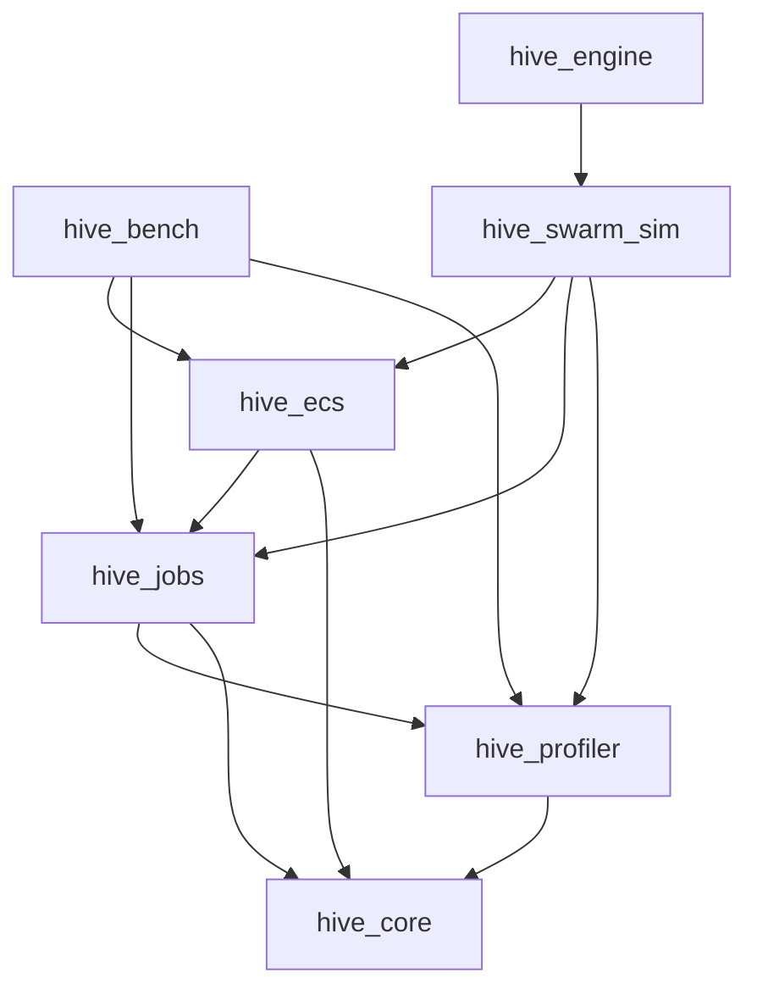

# hive-engine

C++20 work-stealing job system and archetype-based SoA ECS, with a custom profiler and a real-time Swarm boids demo (raylib + ImGui).

<!-- Demo GIF: drop docs/media/swarm.gif, then replace this comment with:

-->

## Architecture



- `hive_core` — allocators and math.
- `hive_profiler` — `PROFILE_SCOPE`, per-thread buffers, Chrome Trace export.
- `hive_jobs` — Chase-Lev deques, scheduler, `parallel_for`, dependency counters.
- `hive_ecs` — generational entities, 16 KB SoA chunks, typed queries, command buffers, wavefront system scheduling.
- `hive_swarm_sim` / `hive_engine` — boids, spatial grid, instanced rendering, ImGui panel.
- `hive_bench` — Google Benchmark suite (built with the Release preset).

## Results

Release, Google Benchmark, 12 logical CPUs. Source JSON lives in [`docs/bench/`](docs/bench/). Times are wall time, rounded.

| Benchmark | 1 thread | 8 threads | What it measures |
|---|---|---|---|
| Work-stealing, medium kernel | 7.21 ms | 1.35 ms | 1M items, grain 1024, Chase-Lev |
| Mutex queue, medium kernel | 9.09 ms | 1.57 ms | Same work, one locked queue |
| Parallel ECS query | 1.39 ms | 0.51 ms | 1M entities, one job per chunk |
| Independent systems | 2.48 ms | 1.45 ms | Two non-overlapping systems in one wave |

| Layout | Time | What it measures |
|---|---|---|
| AoS | 1.40 ms | 1M `Position`/`Velocity` integrate |
| SoA | 1.08 ms | Same work, separate arrays |
| Archetype chunks | 1.31 ms | Same work through ECS storage |

Tiny jobs (1M increments) still scale on work-stealing (0.69 ms → 0.22 ms from 1→8 threads). The mutex queue stops improving past four threads (0.30 ms at 8).

Re-running the suite writes new JSON under `build/`, so these snapshots stay as the published numbers.

The demo ImGui panel has live per-pass timings, thread count, spatial grid on/off, and SoA vs AoS. Use that panel for frame time.

## Design notes

**Why Chase-Lev.** Each worker owns a deque: it pushes and pops locally, and idle workers steal from the opposite end. The common path stays on one cache line per thread. A single mutex queue serializes every `schedule`. Tiny jobs make that lock the whole benchmark; the medium kernel still wins on steal vs lock at 8 threads.

**Why archetype SoA chunks.** Entities with the same component set share 16 KB chunks of columns, not an array of structs. A `query<Position, const Velocity>` walks two tight arrays. Chunks are the parallel grain: one job per chunk, and adding or removing a component copies a bounded row instead of a whole archetype blob. SoA still wins the raw-layout bench; the archetype path pays for generational handles and migration and stays close.

## Prerequisites

- CMake 3.25+
- Ninja
- C++20 compiler: MSVC (`cl`) on Windows, Clang or GCC on Linux
- Network on the first configure — raylib, ImGui, Catch2, and Google Benchmark come from FetchContent

Windows: run from a Visual Studio Developer PowerShell (or after `vcvars64.bat`) so `cl` and the Windows SDK are on `PATH`.

Linux packages (Debian/Ubuntu, same set as CI):

```text
sudo apt-get install -y ninja-build libgl1-mesa-dev libglu1-mesa-dev \
  libx11-dev libxrandr-dev libxi-dev libxinerama-dev libxcursor-dev libxkbcommon-dev
```

## One-command reproduce

Configures Release, builds, runs tests, and writes Google Benchmark JSON to `build/release/bench-results/`. It does not open the demo window.

Windows:

```text
powershell -ExecutionPolicy Bypass -File scripts/reproduce.ps1
```

Linux / macOS:

```text
chmod +x scripts/reproduce.sh
./scripts/reproduce.sh
```

## Build and run by hand

```text
cmake --preset debug
cmake --build --preset debug
```

Debug demo: `build/debug/hive_engine` (Windows: `build\debug\hive_engine.exe`).

Release (the measurement build; `hive_bench` is enabled automatically):

```text
cmake --preset release
cmake --build --preset release
```

Release demo: `build/release/hive_engine` (Windows: `build\release\hive_engine.exe`).

ImGui panel: entity count, thread count, spatial grid on/off, SoA vs AoS, per-pass timings, Dump `trace.json`.

Tests:

```text
ctest --preset debug --output-on-failure
```

Benchmarks (after a Release build):

```text
cmake --build --preset release --target hive_bench
build/release/bench/hive_bench --benchmark_out=build/release/bench-results/hive_bench.json --benchmark_out_format=json
```

Windows binary: `build\release\bench\hive_bench.exe`. Create `build/release/bench-results/` first if you run this by hand.

Sanitizer presets: `asan` (ASan + UBSan) and `tsan` (TSan, Linux). CI builds Windows Debug/Release and Linux ASan/TSan.
